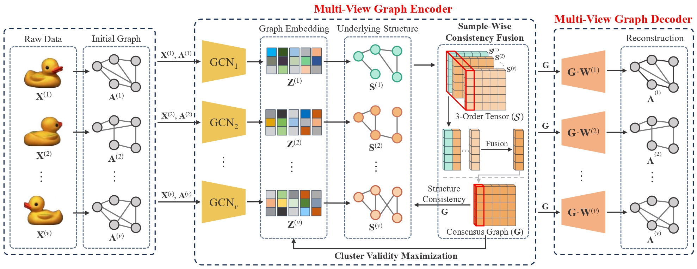

<<<<<<< HEAD
# Locality-Driven Flexible Consensus Graph Learning for Multi-View Clustering  (PR, 2026)

The code for "Locality-Driven Flexible Consensus Graph Learning" (LFCGL).




## Run LFCGL

```python
Python main.py
```

The proposed LFCGL is implemented with Pytorch framework.

## Citation

```
@article{LFCGL,
  title={Locality-driven flexible consensus graph learning for multi-view clustering},
  author={Wang, Bocheng and Wang, Jiawei and Zeng, Chusheng and Chen, Mulin},
  journal={Pattern Recognition},
  volume={169},
  pages={111853},
  year={2026}
}
```

=======
# Locality-Driven Flexible Consensus Graph Learning for Multi-View Clustering  (PR, 2026)

The code for "Locality-Driven Flexible Consensus Graph Learning" (LFCGL).


## Run LFCGL

```python
Python main.py
```

The proposed LFCGL is implemented with Pytorch framework.

## Citation

```
@article{LFCGL,
  title={Locality-driven flexible consensus graph learning for multi-view clustering},
  author={Wang, Bocheng and Wang, Jiawei and Zeng, Chusheng and Chen, Mulin},
  journal={Pattern Recognition},
  volume={169},
  pages={111853},
  year={2026}
}
```

>>>>>>> 3695aa0d5f1ff49ddeae83ed76f104d5baaf29b7
